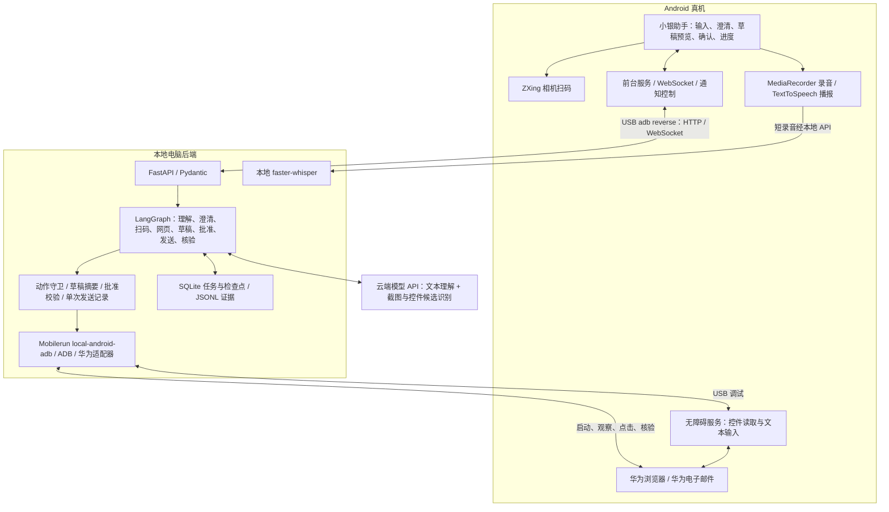
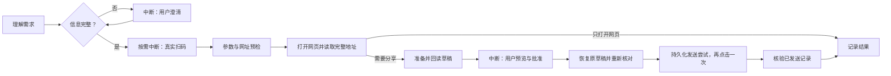

# SilverGuide / 小银助手

**An Explainable Mobile GUI Agent for Older Adults**

[](https://github.com/yzcchally/project_demo/actions/workflows/ci.yml)

SilverGuide 是一个面向老年人操作场景的 Android 跨 App 任务助手原型。用户用文字或中文语音描述目标，系统理解需求、澄清缺失信息，在真实手机上完成 **扫码 → 打开并核对网页 → 准备邮件 → 用户确认 → 尝试发送一次 → 独立核验结果**。

当前部署方式为 **本地电脑后端 + USB 连接的安卓手机 + 云端语言／视觉模型 API**。手机负责交互、扫码、录音和无障碍操作；电脑负责工作流、模型调用、设备控制和证据记录。项目已经在 Mac 与华为真机上完成主要链路验收，仍属于针对指定应用适配的受控原型。

本文对应 2026-10-26 的实现。详细实测范围见 [验收记录](docs/ACCEPTANCE.md)，课程实验方案见 [演示与评估](docs/DEMO_AND_EVALUATION.md)。

## 目录

- [当前功能与支持范围](#当前功能与支持范围)
- [整体架构](#整体架构)
- [技术栈](#技术栈)
- [核心功能如何实现](#核心功能如何实现)
- [模型与程序的职责](#模型与程序的职责)
- [代码结构](#代码结构)
- [安装与运行](#安装与运行)
- [完整演示案例](#完整演示案例)
- [后端接口](#后端接口)
- [测试与验收](#测试与验收)
- [数据与隐私](#数据与隐私)
- [常见问题与后续工作](#常见问题与后续工作)
- [更多文档](#更多文档)

## 当前功能与支持范围

| 能力 | 当前实现 | 验证范围 |
| --- | --- | --- |
| 自然语言任务 | 结构化理解任务类型、收件人／称呼、主题、正文和网址；不支持的目标明确停止 | 已做真实模型调用和小样本检查 |
| 联系人澄清 | 未知称呼要求用户提供完整邮箱，可保存、修改、删除称呼映射；多个可能收件人要求澄清 | 已接入 App、后端和持久化 |
| 真实扫码 | App 内相机扫描二维码，实际结果与当前扫码轮次绑定 | 真机完成扫描、暂停、继续和取消 |
| 网页核对 | 打开华为浏览器，读取原生完整地址，与目标 HTTPS URL 比较 | 主链路及当前网页地址读取通过 |
| 华为邮件草稿 | 填写并回读收件人、中文主题、完整正文和网址，处理默认签名 | 已完成真实草稿与发信验收 |
| 发送前确认 | App 展示完整草稿，可编辑；用户勾选核对并确认后才允许发送 | 真机完成，旧批准失效等边界有回归覆盖 |
| 结果核验 | 单次发送后查找匹配的已发送详情；另外保存人工收件确认 | 已发送核验与用户收件确认均通过 |
| 进度与控制 | WebSocket、后台前台服务、通知栏暂停／继续／取消、事件回放 | 通知控制和扫码控制已做真机检查 |
| 中文语音 | 手机短录音 → 电脑本地 Whisper 转文字；手机 TTS 播报进度 | 用户实际确认过中文输入和播报 |
| 持久化与评估 | SQLite 任务与检查点、动作／事件证据、试运行报告、基础反馈对照模式 | 自动化回归及本机试运行记录 |

后端定义了四类目标：

| 任务类型 | 用户目标 | 当前验收边界 |
| --- | --- | --- |
| `scan_and_share` | 扫描二维码，把网页链接通过邮件分享 | 已完成真实端到端流程 |
| `share_url` | 分享需求中明确给出的网址 | 已实现，尚未完成独立的系统性多轮验收 |
| `share_current_page` | 读取并分享当前浏览器网页 | 原生完整地址读取已做真机检查；独立发信场景仍需补充多轮验收 |
| `open_url` | 扫码或提供网址，只打开并核对网页 | 已实现；网页操作和扫码控制已有真机证据 |

**当前跨 App 链路使用华为浏览器与华为自带“电子邮件”两个外部应用。** 扫码器位于小银助手内部。Outlook、QQ 邮箱及原生 Gmail 安卓客户端尚未完成同等适配；电脑 Chrome 中的 Gmail 只用于人工核对收件。发信通过手机邮件客户端完成，没有接入 Gmail 发信 API 或直接 SMTP 发信。

## 整体架构



手机请求 `127.0.0.1:8000`，由 `adb reverse` 转发到电脑后端。后端监听电脑回环地址，使用本机 USB 设备适配器操作手机。自然语言理解和视觉判断需要所配置模型服务的网络连接；可选语音识别模型下载后在电脑本地运行。

## 技术栈

版本以仓库依赖声明为准：[Android 依赖](gradle/libs.versions.toml)、[Android 构建](app/build.gradle.kts)、[Python 依赖](backend/requirements.txt)、[语音依赖](backend/requirements-speech.txt)。

| 层次 | 技术与当前版本 | 在项目中的职责 |
| --- | --- | --- |
| Android UI | Kotlin 2.2.10、Jetpack Compose BOM 2026.02.01、Material 3 | 任务输入、联系人、草稿确认、大字操作和进度界面 |
| Android 生命周期 | Activity Compose 1.13.0、Lifecycle 2.11.0、Core KTX 1.19.1 | 页面恢复、录音生命周期、后台任务连接 |
| Android 网络 | OkHttp 4.12.0；常规任务 HTTP 使用 `HttpURLConnection` | WebSocket、通知控制请求、任务 API |
| 扫码 | JourneyApps / ZXing Embedded 4.3.0 | 内置相机扫码 Activity 与真实二维码结果 |
| 手机语音 | Android `MediaRecorder`、`TextToSpeech` | AAC/M4A 短录音、中文步骤播报 |
| Android 构建 | Gradle 9.6.0、AGP 9.4.1、构建 JDK 25 | APK、JVM 测试与 lint；Java 源码兼容级别为 11 |
| Android 平台 | `compileSdk/targetSdk=37`、`minSdk=24` | 当前 SDK 包名为 `platforms;android-37.0`；实测手机为 Android 12 / API 31 |
| 后端运行时 | Python 3.12、FastAPI 0.153.0、Uvicorn 0.54.0 | HTTP、WebSocket 和本地服务入口 |
| 数据契约 | Pydantic 2.14.1 | 任务、模型输出、控制请求与字段校验 |
| 工作流 | LangGraph 1.2.17、SQLite checkpointer 3.1.2 | 图执行、人机交互中断、恢复与检查点 |
| 模型调用 | OpenAI 兼容 Python SDK `openai==3.35.1`，默认连接 DeepSeek | 文本任务理解、图像与界面候选识别；使用 SDK 不代表调用 OpenAI 服务 |
| 设备控制 | `mobilerun-core[local]==1.10.1`、`mobilerun-core-local==0.7.0`、ADB | `local-android-adb` 观察和操作，结合华为应用专用适配 |
| 本地 ASR | `faster-whisper==1.2.1`、`av==16.1.0`、Whisper base | CPU / int8 中文转写，无需外部 ASR 服务 |
| 数据与日志 | SQLite、JSONL、Android SharedPreferences | 任务、联系人、发送记录、检查点、事件游标和本地界面证据 |
| 测试与 CI | pytest 9.1.1、pytest-asyncio 1.4.1、httpx 0.28.1、JUnit、GitHub Actions | 后端回归、Android JVM 测试、Debug 构建与 lint |

## 核心功能如何实现

### 1. 从一句需求进入可恢复工作流

App 将原始需求提交给后端，模型返回经过 Pydantic 校验的 `TaskIntent`。程序再核对用户明确给出的邮箱、网址和已保存联系人：未知称呼、缺少必需字段或存在多个收件人时，进入澄清页面，不让模型猜地址。联系人称呼与邮箱的关联只有用户明确保存后才生效。

工作流使用真正的 `StateGraph`，在澄清、扫码和批准处调用 `interrupt()`，收到有效输入后用 `Command(resume=...)` 恢复；图检查点保存在 SQLite。主要链路如下，`open_url` 在网页核对完成后结束：



### 2. 真实扫码与完整网址核对

内置 ZXing 扫码器将实际相机结果连同 `scan_nonce` 交回后端。暂停、继续或重新扫码会管理相机生命周期及轮次；旧轮次的回调不能覆盖当前结果。扫码界面有超时，可重新打开。

网址校验只接受符合约束的 HTTPS 公网域名形式，拒绝 IP、localhost／本地域名、嵌入账号密码及非默认端口等。随后通过 Android Intent 打开浏览器，读取华为浏览器原生完整地址，包括必要时展开隐藏地址栏。网页正文中的链接、仅显示域名的控件或其他应用的文字不能作为完整地址证据；跳转后地址不符则停止核对。

这是输入格式和页面一致性检查，尚未实现完整的 DNS、网站信誉或恶意网页检测。

### 3. 截图与界面树共同识别

后端通过设备适配器观察手机，取得截图与 Android UI 树。感知层从当前写信页提取收件人、主题、正文候选，附上资源 ID、角色、边界、文字和内容描述，为候选生成当前观察有效的 `target_id`。

默认 Mobilerun 路径的视觉请求同时提供 **PNG 截图、界面候选和预期草稿**；原生 ADB 回退路径当前不附截图，只提交结构化观察。模型返回页面类别及填写建议；动作守卫逐项核对候选是否存在、字段角色是否一致、输入是否等于当前草稿。可执行建议限制为 `enter_text`、`tap_element`、`wait`，模型不能输出任意坐标或 shell，也不能批准或发送邮件。无效建议最多触发一次重新观察与提议，再不满足约束就停止。

因此，界面识别结合了多模态模型判断、Android 原生控件信息与应用适配规则；本项目没有训练自己的视觉识别模型。

### 4. 华为邮件适配与草稿回读

程序通过 `ACTION_SENDTO` / `mailto:` 打开原生邮件写信页并预填内容，再结合受限模型建议和无障碍字段输入修正草稿。已经正确的字段无需再次输入。回读必须匹配唯一目标收件人、完整中文主题、完整正文、网址及任务标记，并检查额外抄送、密送或附件；默认签名也在正文核对范围内。

每封任务邮件附带 `[SilverGuide:…]` 唯一标记，用于后续定位对应记录。准备完成后返回小银助手展示全部内容，用户可以编辑；编辑会重新准备并核对草稿，同时废除旧批准。

### 5. 发送授权、幂等与结果区分

- **批准绑定当前内容：** 请求携带 `task_id + draft_digest + approval_nonce`。过期摘要、旧批准或错误阶段不能触发发送；App 要求用户核对后勾选并确认。
- **发送前再次核对：** 恢复原来的写信页并读取内容；若草稿变化，进入 `needs_review`，要求重新处理。
- **先登记，再点击：** 在点击发送之前持久化 `send_attempts=1`；重复确认、同请求键重复提交、后端重启不能自动重放这次发送。
- **发送记录与收件分开：** 自动进入已发送邮件详情，核对收件人、主题、完整正文和任务标记，记录 `sent_record_verified`；收件人实际收到后的人工确认另记 `delivery_confirmed`。
- **不确定就只核验：** 已尝试发送却找不到足够证据时进入 `outcome_unknown`，提供 `verify_only`，不自动重发。

这些机制约束的是本系统的单次发送尝试，不能保证网络邮件系统端到端“恰好一次”送达。取消也不能撤回已经提交给邮件客户端的邮件。批准机制适用于当前受信任的本机客户端，尚未构建生产级多用户身份认证。

### 6. 实时进度、暂停与故障恢复

Android `TaskConnectionService` 以前台服务维持 WebSocket，在浏览器或邮件处于前台时继续显示通知、播报进度并接收暂停／继续／取消。客户端保存任务、事件游标和近期事件，断线后按游标回放；页面恢复时补读一次快照，原来的两秒任务进度轮询已移除。

暂停和取消在动作检查点生效；进行中的模型／系统调用受各自超时约束，不能保证瞬间中断。后端重启后，未完成且没有发送尝试的任务标为 `interrupted`，需要明确恢复；已登记发送尝试的未完成任务进入结果未知处理，不自动重放外部操作。

常见状态包括 `needs_clarification`、`awaiting_qr`、`awaiting_confirmation`、`paused`、`needs_review`、`completed`、`failed`、`cancelled`、`interrupted` 和 `outcome_unknown`。`completed` 的含义要结合任务类型与证据标志判断，不能统一理解为“对方已收件”。

### 7. 中文语音与步骤解释

用户点击“说出您的需求”录制最多 20 秒的短音频，再点击“说完了，转成文字”。手机通过本地 API 将 AAC 录音交给电脑，由 faster-whisper / Whisper base 转写；识别完成后由用户核对文字。仅说“主题是……，正文是……”可填写手动表单，明确的扫码／分享目标才进入 Agent 流程。取消或离开录音页面会停止并清理临时录音，识别失败可改用文字输入。

中文播报使用手机已有 TTS 引擎。步骤解释由实际任务状态、失败原因和已有证据生成；`silverguide` 与 `basic` 模式共用规划、执行和安全规则，主要区别是反馈信息的详细程度。当前没有完成正式的适老用户效果评估。

## 模型与程序的职责

| 环节 | 模型负责 | 程序负责 |
| --- | --- | --- |
| 需求理解 | 将自然语言提取为任务候选 | Schema 校验、联系人查找、地址来源核对、澄清与支持范围 |
| 界面感知 | 根据截图与候选判断写信页、建议字段动作 | 获取观察、生成候选、校验目标和内容、实际执行 |
| 跨 App 推进 | 在受控节点提供理解／感知结果 | LangGraph 流程、Intent、设备操作、应用适配 |
| 发送授权 | 无批准权限 | 用户确认、摘要与 nonce 校验、发送前回读、单次尝试登记 |
| 完成判断 | 模型输出不作为发送成功证据 | 独立核对已发送记录，单独记录人工收件确认 |

当前代码向 DeepSeek 请求的默认模型标识为 `deepseek-v4-flash-vision-exp`，文本理解与图像感知分开调用，可分别配置。该字符串是请求标识，实际服务端版本及其可用性由提供商决定。视觉调用包含图片，属于多模态使用；文字理解调用只提交对应的文字数据。具体实现见 [ModelGateway](backend/agent/models.py)。

这是一条带模型能力的受控工作流，不是让模型自由操纵任意 App 的通用代理。旧版“打开设置”等识别调试入口仍保留，但邮件操作必须走当前批准流程，旧的直接 Gmail 发信入口已禁用。

## 代码结构

```text
app/src/main/java/com/example/demo/
├── MainActivity.kt              # App 入口与主界面集成
├── WorkflowScreen.kt            # 任务输入、澄清、预览、批准与进度
├── TaskConnectionService.kt     # WebSocket 前台服务、通知与播报
├── TaskCaptureActivity.kt       # 扫码生命周期与结果回传
├── LocalVoiceInput.kt           # 短录音、转写请求与清理
├── TaskInstruction.kt           # 语音／文字字段提取
├── MailAccessibilityService.kt  # 无障碍读取与字段输入
└── A11yCommandReceiver.kt       # 受限的 ADB 无障碍命令桥
backend/
├── main.py                     # 统一启动入口，加载本地 .env
├── api/                        # API、Schema、WebSocket 事件
├── agent/                      # LangGraph、运行时、模型网关
├── perception/                 # 界面观察和字段候选
├── safety/                     # 模型动作守卫
├── device/                     # Mobilerun 与华为应用适配
├── verification/               # 邮件内容与已发送证据核验
├── storage/                    # SQLite 任务、联系人与事件
├── explanation/                # 基于事实的步骤解释
├── evaluation/                 # 试运行指标与证据统计
├── domain.py                   # URL、草稿等公共规则
├── speech_api.py               # 本地中文语音接口
├── test_*.py                   # 后端回归测试
└── gmail_demo.py 等             # 历史兼容与底层辅助；非当前 Gmail 发信流程
tools/                          # 语音模型准备、评估、证据清理与录屏辅助
docs/                           # 架构、接口、验收、演示和课程报告
.github/workflows/ci.yml         # 后端与 Android CI
```

## 安装与运行

### 前置条件

- 一台电脑，Python 3.12、JDK 25、Android SDK Platform Tools 与 API 37 SDK。Mac 已做本机运行验证；Windows 可使用相同 Python 代码和 Gradle Wrapper，完整的 Windows 真机链路尚未单独验收。
- 一台支持 USB 调试的 Android 手机。最低 SDK 为 24，但当前应用适配实测范围是华为 ELS-AN00 / Android 12，不能据此推定所有 Android 7+ 设备均兼容。
- 手机上已登录华为“电子邮件”，并准备一个自己有权使用的测试收件邮箱；自动化过程中保持手机解锁。
- 可用的模型 API 密钥和网络。设置好 `JAVA_HOME`、`ANDROID_HOME`，将 SDK 的 `platform-tools` 加入 `PATH`。SDK Manager 对应平台包为 `platforms;android-37.0`。

```bash
git clone https://github.com/yzcchally/project_demo.git
cd project_demo
```

Android Studio 可打开仓库根目录。若本机没有 `local.properties`，可由 Android Studio 写入本机 SDK 路径，或正确设置 `ANDROID_HOME`；不要把本机路径提交到 Git。

### 1. 创建 Python 环境

macOS / Linux 终端：

```bash
python3.12 -m venv .venv
.venv/bin/python -m pip install -r backend/requirements-dev.txt
test -f .env || cp .env.example .env
```

Windows PowerShell：

```powershell
py -3.12 -m venv .venv
.\.venv\Scripts\python.exe -m pip install -r backend/requirements-dev.txt
if (!(Test-Path .env)) { Copy-Item .env.example .env }
```

仅运行后端时可安装 `backend/requirements.txt`；开发依赖另外包含测试工具。若沿用本机用 uv 创建且没有 pip 的虚拟环境，可使用 `uv pip install --python .venv/bin/python -r backend/requirements-dev.txt`。

编辑本地 `.env`，填写自己的密钥，不要提交此文件：

```dotenv
DEEPSEEK_API_KEY=请填入自己的密钥
SILVERGUIDE_TEXT_MODEL=deepseek-v4-flash-vision-exp
SILVERGUIDE_VISION_MODEL=deepseek-v4-flash-vision-exp
SILVERGUIDE_MODEL_BASE_URL=https://api.deepseek.com
SILVERGUIDE_DEVICE_BACKEND=mobilerun
```

文本和视觉模型可分别替换，但视觉模型必须支持当前图片请求格式。更换提供商时需检查 API、模型标识和密钥读取方式；当前读取的密钥变量仍为 `DEEPSEEK_API_KEY`。`ADB_PATH` 可指定 ADB 路径，`SILVERGUIDE_DEVICE_BACKEND=adb` 可选择原生适配回退；这不等于更换了应用适配范围。

### 2. 可选：准备本地语音

macOS：

```bash
.venv/bin/python -m pip install -r backend/requirements-speech.txt
.venv/bin/python tools/prepare_speech.py
```

Windows PowerShell：

```powershell
.\.venv\Scripts\python.exe -m pip install -r backend/requirements-speech.txt
.\.venv\Scripts\python.exe tools/prepare_speech.py
```

模型准备脚本首次需要联网下载，将固定 revision 的 Whisper base 转换模型保存到 `.run/models/whisper-base/`。启动后端后可通过 `/speech/status` 检查就绪情况。自定义目录使用 `SPEECH_MODEL_PATH`。未安装语音依赖或模型时仍可使用文字输入。`av==16.1.0` 是当前解码器验证过的配套版本，不建议单独升级而不验证。

### 3. 启动后端

macOS：

```bash
./start_backend.command
```

Windows PowerShell：

```powershell
.\.venv\Scripts\python.exe backend/main.py
```

保持此终端运行。检查 [健康接口](http://127.0.0.1:8000/health) 和 [交互式 API 文档](http://127.0.0.1:8000/docs)。macOS 也可直接执行 `.venv/bin/python backend/main.py`。

### 4. 构建、连接与安装手机 App

手机开启开发者选项和 USB 调试，用支持数据传输的 USB 线连接电脑，在手机上允许调试授权。`adb devices -l` 应显示一台状态为 `device` 的手机。

macOS 的仓库脚本会构建、设置端口转发、安装并启动 App：

```bash
./build_android.command assembleDebug
./connect_phone.command
```

Windows PowerShell 在另一个终端执行：

```powershell
.\gradlew.bat assembleDebug
adb devices -l
adb reverse tcp:8000 tcp:8000
adb install -r app/build/outputs/apk/debug/app-debug.apk
adb shell am start -n com.example.demo/.MainActivity
```

安装后，**系统中的应用名和无障碍服务名仍是 `Demo`，App 页面显示“小银助手”**。请手动开启 Demo 无障碍服务，并根据需要允许相机、麦克风和通知权限。在 App 中检查手机连接，保持解锁后开始测试。手机重新连接或重启后，应重新执行 `adb reverse tcp:8000 tcp:8000`。

## 完整演示案例

先用自己的两个测试账号演示，确认发件账号已在华为邮件登录，收件账号能够由本人查看。

1. 输入：“帮我扫描二维码，把网址发给测试收件人，主题是 SilverGuide 演示，正文是请查看这个网页。”点击“让小银完成这个任务”。也可录音后先核对识别文字。
2. 首次出现“测试收件人”时，填写自己控制的真实收件邮箱，可勾选保存称呼。每轮使用不同主题便于区分。
3. 手机扫码器打开后，扫描下面的测试二维码。预期结果为 `https://example.org/`，等待浏览器核对和邮件草稿准备。
4. 返回小银助手核对完整收件人、主题、正文、网址和任务标记。需要修改时先编辑，等待重新核对。
5. 内容无误后，勾选核对选项并点击“确认发送这封邮件”。观察已发送核验结果；不要因等待而自行重复点击原生邮件发送键。
6. 在收件邮箱查看邮件，实际收到且内容正确后，回 App 点击人工收件确认。

<a href="docs/fixtures/share-link-qr.png"></a>

[打开完整二维码图片](docs/fixtures/share-link-qr.png)。发送前暂停／继续／取消可作为补充演示；取消测试不要再确认发送。已有的本机录屏与试运行记录未随源码公开，演示脚本、场景及证据口径见 [演示与评估文档](docs/DEMO_AND_EVALUATION.md)。

## 后端接口

主任务入口使用 `/api` 路径；完整字段约定见 [API_CONTRACT.md](docs/API_CONTRACT.md)，运行时以 `/docs` 为准。

| 接口 | 用途 |
| --- | --- |
| `POST /api/tasks` | 创建自然语言任务，携带 `instruction`、`request_key` 和可选评估模式信息 |
| `GET /api/tasks/latest`、`GET /api/tasks/{id}` | 获取最近任务或指定任务的完整状态与证据标志 |
| `POST /api/tasks/{id}/clarify`、`/qr` | 提交明确澄清信息或当前轮次的真实扫码结果 |
| `PATCH /api/tasks/{id}/draft` | 编辑草稿，废除旧批准并重新准备 |
| `POST /api/tasks/{id}/confirm` | 提交与当前摘要、批准 nonce 绑定的明确确认 |
| `POST /api/tasks/{id}/pause`、`/resume`、`/cancel` | 控制当前任务 |
| `POST /api/tasks/{id}/control` | 包含发送前重试 `retry_prepare`、发送后仅核验 `verify_only` |
| `POST /api/tasks/{id}/received` | 记录用户核对实际收件的确认 |
| `GET /api/tasks/{id}/events?after=0`、`/explain` | 有序事件及当前状态解释；事件每页最多 100 条 |
| `GET/PUT /api/contacts`、`DELETE /api/contacts/{alias}` | 管理明确保存的称呼与邮箱 |
| `GET /api/system/graph`、`GET /api/evaluation` | 实际编译图的 Mermaid、试运行评估 |
| `GET /speech/status`、`POST /speech/transcribe` | 本地语音就绪检查和短音频转写 |
| `WS /ws/tasks/{id}?after=<cursor>` | 首次快照、实时进度、心跳与断线游标恢复 |

## 测试与验收

macOS 本地检查：

```bash
.venv/bin/python -m pytest backend -q
./build_android.command assembleDebug testDebugUnitTest lintDebug
.venv/bin/python tools/evaluate.py
```

Windows 对应使用 `.\.venv\Scripts\python.exe` 和 `.\gradlew.bat`。测试中的设备／模型替身用于覆盖故障边界，不需要真实密钥，也不能代替真机验收。

截至本文记录版本：

- 后端 **70 项测试通过，另有 13 个 unittest 子测试通过**，覆盖图中断恢复、联系人歧义、扫码 nonce、动作守卫、批准失效、幂等、发送前变化、发送登记后故障、迟到结果和 WebSocket 回放等。
- Android **4 项 JVM 测试通过**，Debug 构建与 lint 完成；已有本机报告为 0 errors、27 warnings。GitHub Actions 同时执行后端与 Android 检查，当前结果见文首徽章。
- 真机主链路完成真实扫码、完整网页地址核对、中文草稿、用户批准、一次发送、已发送详情核验，以及用户确认实际收件；中文语音和后台通知控制也有单独证据。
- 5 个预先定义的真实模型理解样本通过，**这是需求理解小样本，不是视觉识别准确率或 GUI 任务成功率**。

正式的 **12 场景 × 3 次、共 36 次真机实验**、B0/B1 对照和老年用户研究尚未完成。录屏中的一次模型建议被安全守卫拒绝后，由开发者修复适配再重试，应算开发者参与的过程，不能当作自主恢复。不能据现有工程测试声称已经证明老年人的独立完成率、信任或认知负荷改善。

`tools/evaluate.py` 从持久化任务生成试运行报告：成功需要证据，安全停止、失败和结果未知分别统计；未测量指标保留 `null`。当前任务时长包含人工等待及后续核查，不代表纯模型或 GUI 执行耗时。详细定义见 [验收记录](docs/ACCEPTANCE.md) 和 [评估协议](docs/DEMO_AND_EVALUATION.md)。

## 数据与隐私

| 数据 | 当前存放与使用方式 |
| --- | --- |
| 模型密钥 | 电脑本地 `.env`，由后端读取，不打包进 APK；该文件被 Git 忽略 |
| 任务、联系人、发送尝试 | `.run/workflows/` 下的 SQLite 数据库 |
| 图执行检查点 | `.run/workflows/checkpoints.sqlite3` |
| 界面与执行证据 | 任务目录内的事件、动作、UI XML 等；可能包含真实邮箱与邮件内容 |
| 模型调用元数据 | 阶段、请求模型名、输入摘要、token、耗时及结果；不记录原始提示词或密钥 |
| 语音 | 手机临时录音经 USB 转发交给电脑本地 ASR，完成或取消后清理临时音频；模型文件保留本机 |

**本地语音识别不代表所有数据都留在本机。** 自然语言需求、用于感知的截图、界面候选及预期草稿会发送给所配置的云端模型服务；演示时应使用获得授权的测试账号与内容。

`.env`、虚拟环境、本机 SDK 路径、构建产物及 `.run/` 中的数据库、日志、截图和录屏不随代码提交。证据清理工具 `tools/prune_evidence.py` 默认仅预览 30 天前终态任务的屏幕文件，显式 `--apply` 才删除，保留任务及防重复记录；这不是完整的数据匿名化或自动保留期限系统。

当前后端只监听回环地址，并限制 Host 与 WebSocket 网页 Origin；没有生产级远程账号认证、多租户隔离或多设备调度，不应直接改成公网服务使用。

## 常见问题与后续工作

| 现象 | 检查与处理 |
| --- | --- |
| `adb devices` 显示 `unauthorized` 或无设备 | 解锁手机，允许 USB 调试，检查数据线和连接模式；本项目按单手机使用 |
| App 连不上后端 | 保持后端终端运行，检查 `/health`，重新执行 `adb reverse tcp:8000 tcp:8000` |
| 可以打开 App，但不能读写邮件字段 | 在系统设置中启用 **Demo 无障碍服务**，保持解锁；重新安装后需检查服务是否仍开启 |
| 语音没有转出文字 | 允许麦克风权限，点击“说完了，转成文字”，检查 `/speech/status` 与语音模型；失败时可用文字输入 |
| 浏览器地址不一致或模型动作被拒绝 | 查看当前解释和证据，确认应用及页面属于适配范围；不要绕过守卫或把页面正文当作地址 |
| 发信后结果未知 | 只重新核验已发送和收件情况，不自动重发；确认取消不能撤回已提交邮件 |

后续优先方向包括：更多手机／应用版本的兼容性、Outlook 等邮件适配、失败重试后的前台服务与进度展示边界、系统性异常真机测试、正式对照实验及适老用户研究。当前没有实现手机脱离电脑独立运行，也没有任意 App、支付或密码操作能力。

课程范围还需确认：项目使用 companion 内的扫码器，与提案优先使用已有扫码 App 的路线存在调整；浏览器和邮件是两个外部 App，是否符合课程对第三方 App 数量的解释，应由团队与教师核对。

## 更多文档

| 文档 | 内容 |
| --- | --- |
| [简明运行说明](docs/README.md) | 已配置环境的日常启动与开发命令 |
| [Mac 环境说明](docs/MAC_SETUP.md) | 本机环境配置与早期运行过程 |
| [架构设计](docs/ARCHITECTURE.md) | 模块边界、执行与持久化设计 |
| [接口契约](docs/API_CONTRACT.md) | 请求、事件、状态及幂等约定 |
| [验收记录](docs/ACCEPTANCE.md) | 当前真实证据、限制与尚未完成的验收 |
| [演示与评估](docs/DEMO_AND_EVALUATION.md) | 演示步骤、12 场景及评估口径 |
| [英文实现报告](docs/IMPLEMENTATION_REPORT_EN.md) | 课程报告源文档 |
| [AI 使用与团队贡献](docs/AI_USAGE_AND_CONTRIBUTIONS.md) | AI 辅助说明与待团队填写的真实成员贡献 |
