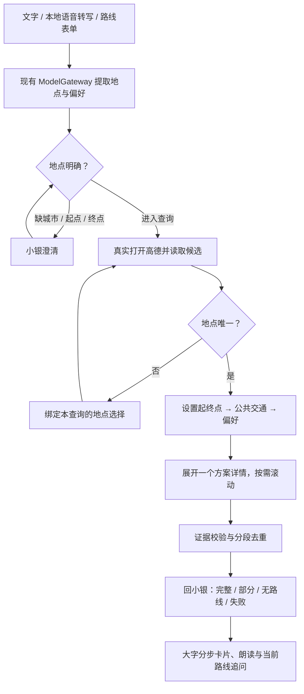

# 高德公交 / 地铁路线功能

本功能在 SilverGuide 现有仓库和任务服务中扩展 `plan_transit`。用户在小银填写或说出地点，后端真实操作高德地图查询公共交通方案，读取方案详情，再回到小银显示大字步骤卡片和中文朗读。

这是**出发前路线安排**。系统不会点击“开始导航”，不会购票或付款，也不会借用邮件批准、发送或收件确认来表示路线成功。

高德默认使用 `rules` 原有应用适配逻辑。可单独启用 [AutoGLM 单步辅助](AUTOGLM_ASSIST.md)：规则确实找不到已支持步骤的控件时，才会请求候选点击并独立核验。旧的 `autoglm` 全程模型决策实验模式仍需显式选择，与规则主导辅助分开；具体见 [历史说明](AUTOGLM_TRANSIT.md)。两种执行路径共用现有结果验证与任务控制。

当前运行方式仍是 **Mac 后端 + USB 连接的 Android 手机 + 现有云端模型服务**。这次没有迁移成手机独立运行版本。实际命令、真机结果、总耗时和待验项统一记录在 [AMAP_ACCEPTANCE.md](AMAP_ACCEPTANCE.md)；课堂操作见 [AMAP_DEMO.md](AMAP_DEMO.md)。

## 运行条件与适配范围

| 条件 | 当前要求 |
| --- | --- |
| 手机 | 已授权 USB 调试、保持解锁，启用系统中名为 Demo 的无障碍服务 |
| 高德 | 安装包 `com.autonavi.minimap`；开发观察版本为 `15.13.0.2021`，其他版本的界面不能据此声称兼容 |
| 小银 App | 安装包含路线分支和 `set_transit_field` 命令的新 APK |
| 电脑 | 按主 README 配置 Python、JDK、Android SDK；运行 FastAPI 后端并设置 `adb reverse tcp:8000 tcp:8000` |
| 网络与模型 | 高德能够查询网络路线；电脑现有模型配置可用，密钥保存在被 Git 忽略的 `.env` |
| 截图文字定位 | 当前 macOS 回退使用 Apple Vision 和 `clang` 编译 `tools/amap_ocr.m`；它不是新增在线路线服务 |
| 定位 | 仅在高德已授权且当前地址与城市可核实时使用。没有授权或无法核对时填写明确起点，不代替用户开启权限 |

路线预检检查高德、手机连接、解锁和无障碍，不要求安装或登录华为邮件。邮件任务继续执行原有邮件预检。

Android 只增加高德包可见性，不在小银内新增后台定位采集。当前截图 OCR 回退依赖 macOS；Windows 没有这条 Apple Vision 回退，也没有完成本功能的同等真机验收。

## 从输入到结果



明确起点优先于当前位置。自然语言中指定“从 A 去 B”后，不允许被高德默认的“我的位置”覆盖。用户说“家里”而没有具体地址时，先澄清。

只说目的地时，先通过[高德官方“我的位置”入口](https://lbs.amap.com/api/amap-mobile/guide/android/location)打开真实页面：

```text
androidamap://myLocation?sourceApplication=SilverGuide
```

URI 只打开高德界面，不返回位置或路线 JSON。适配器在当前查询中重新读取页面标题中的完整行政地址和城市，并核对“您当前位置是在……附近”及近距离标识；连续稳定观察通过后，才形成 `source=current_location` 的起点。`我的位置` 占位文字、附近 POI 列表或用户请求中的城市都不能单独充当真实定位地址证据。当前版本保守支持实际观察到的中文行政地址卡片；页面不符合可核对结构时返回小银填写明确起点。

同时使用只读 `backend/device/location_status.py` 交叉检查当前 Android 用户的系统定位开关、该用户的高德精确定位运行时权限、最近被允许的定位访问，以及系统实际 fix 的来源、新鲜度、精度和模拟标志。默认要求实际 fix **不超过 120 秒、精度不大于 100 米、非模拟**，并核对高德近期访问；支持合格的 `gps / network / fused` 来源。时间取设备真实时钟及 elapsed 信息，页面采集时间不会冒充 fix 时间。

只读检查不会申请权限、开启定位、创建 mock provider、请求新的系统定位、调用在线定位／逆地理编码服务。该模块不解析、回传或持久化经纬度，也不保存系统 location dump 原文；本机诊断只保留健康元数据。GUI 中实际显示的地址、城市和本查询证据仍要独立核对，系统健康通过本身不构成路线成功。

权限拒绝、开关关闭、访问不近期、定位过期、精度不足、模拟位置、时钟无法核对、地址或城市不可读、真实城市与请求城市冲突时，均要求用户补充明确起点／城市。每次重新查询生成新 `query_id` 并重新核对，不沿用旧 GPS 选择或演示起点。当前位置若需要用户确认，也只确认本查询的实读位置，保持请求 `origin="" / use_current_location=true`，不改成用户显式输入地址。当前完整定位路线的实际结论仍以验收记录为准。

## 模块职责

| 位置 | 职责 |
| --- | --- |
| `backend/api/schemas.py` | 路线请求、结果、分段、证据、地点选择及独立地图感知契约 |
| `backend/agent/models.py` | 复用现有模型配置和日志；理解地点与偏好、识别高德页面、提取已观察路线事实 |
| `backend/agent/graph.py`、`runtime.py` | 独立路线分支、图中断恢复、查询版本、唯一设备 worker、暂停和取消 |
| `backend/device/amap.py` | 高德 GUI 适配、中文输入、当前控件核对、详情采集和有界等待 |
| `backend/device/location_status.py` | 只读解析当前用户授权、系统定位和高德近期访问、实际 fix 元数据，不采集或保存经纬度 |
| `backend/perception/transit.py`、`backend/safety/transit.py` | 与邮件分离的地图候选、观察标识和动作限制 |
| `backend/transit/validation.py` | 字段来源、当前方案、分段完整性、去重与结果分类 |
| `backend/transit/native.py` | 保守提取当前原生详情列中的站点、线路与方向；结构不足时交给受约束模型提取 |
| `backend/transit/explain.py` | 从已验证结构生成解释和三个即时追问的回答 |
| `app/.../TransitUi.kt` | 路线输入、地点选择、总览、大字步骤、朗读控制和重查 |
| `MailAccessibilityService.kt`、`TransitBridgeProvider.kt` | 受 `DUMP` 权限保护、限定高德当前窗口与输入框的读写桥 |
| `TaskConnectionService.kt` | 复用 WebSocket、通知控制及游标回放；路线主动朗读期间抑制进度语音 |

## 高德页面的实际读取

默认路径为：真实地点搜索 → 核对地点 → 路线 → 设置明确起点 → 公共交通 → 读取偏好和方案列表 → 展开一个方案详情 → 分屏采集。

入口可以使用高德官方 Android URI，但 URI 只负责打开真实 App 页面，不会被假设成返回路线 JSON。当前数据来自实际高德界面，不使用路线 REST API、MCP、隐藏接口、抓包数据或预置路线替代 GUI 查询。

高德查询和详情查看通过 `DUMP` 权限保护的 `ContentProvider.call` 读取当前 Android UI 树（`content://com.example.demo.transit`），结合文字、contentDescription、资源 ID、控件类型和可见边界定位。该桥只序列化高德当前窗口，校验本次随机 nonce、窗口和包名，并限制深度、节点和结果大小。中文输入使用同一接口的 `set_transit_field`，仍需唯一匹配当前控件的资源 ID、边界和原文字。

本机华为曾出现 SDK `/dev/tty` 不返回 XML、UiAutomation 干扰无障碍服务，以及异步广播仍被系统判为超时的兼容问题。路线读写因此不再依赖有序广播，也不在临时失败后转用 UiAutomation／旧文件。需要安装包含 Provider 的新版 App，缺少接口时提示更新或停止。旧 transit 广播明确拒绝执行并提示使用新接口，原邮件广播保持原限制。Mobilerun 的截图和点击能力仍保留；路线操作结束恢复原传输配置，不改变邮件读取路径。

每次点击前重新观察并核对目标，动作通过独立高德候选和守卫绑定当前 `target_id`、页面与 epoch。开发观察中，某些“路线”文字在树中存在但 bounds 为零，不能据此直接点击：适配器会采集当前截图，通过本机 Apple Vision OCR 定位唯一匹配文本，再次截图确认文字及边界仍一致，才允许点击。OCR 回退只用于适配器限定的文字目标，不接受模型输出任意屏幕坐标。

地点搜索卡可能内嵌校门、停车场等快捷入口，不能点击整张卡片的中心。适配器只点击属于当前主卡、名称完全一致且边界唯一的标题子节点，点击前再次核对主卡名称、地址、城市及标题归属；主卡、标题或祖先被明确标记为隐藏时拒绝点击。点击后核对实际详情名称，误入校门时明确停止。请求与详情名称比较只兼容括号标点差异，保留括号内全部名称；校区、校门、停车场和其他校区不能凭名称包含关系互相代替。

路线详情优先按已观察到的原生乘车列提取：同一帧中明确的上车站、线路及方向、站数、下车站才构成一段。该路径不包含预置站名、线路库或地图服务请求。起点步行、站内换乘和终点步行必须在真实 XML 的同一行程容器中，与对应起终点／乘车块形成紧邻、可见的分支关系；验证器会独立重解析原始 XML，不能只信提取器自报连接。多屏可以引用分别读取完整的乘车段，不能拼凑不完整上下车站。只有本查询的真实定位字段与系统健康证据同时成立，才允许把详情中的“我的位置”关联到已核对定位地址。独立步行节点的数字可以保留；“站内外共步行”等汇总数字只在总览显示，不分摊到各段，未显示的街道转弯说明留空。

地点地址保持高德原文；城市可来自行政地址，或同一已核对主 POI 搜索卡中的明确市级专属标签（当前已观察到“……市科普基地”）。也可读取当前地点自己的可见介绍，要求以完整地点名称开头、明确写出“位于／坐落于／地处……市”，并属于同一个带“概述／查看全部”控件的紧凑介绍卡片。隐藏节点、评论／推荐祖先和带计数的评价区均不能提供该证据。各路径保留城市字段的独立来源，不把榜单范围、其他地点介绍、推荐卡或用户搜索词当作行政地址，不拼接未显示的地址前缀。路线提取使用刚回读的正式地点名称，原始请求仍交由独立验证器核对并保留审计。

未知结构或不完整段落交给独立的云端视觉／文本提取契约整理；原生文本充分时不额外发送大图，稀疏时才请求截图补充。模型不复制原始证据到回复中，只返回事实及引用，以减少延迟。本次复杂详情提取使用单次最多 70 秒调用；对官方 DeepSeek 端点仅在这一事实提取阶段关闭 thinking，其他任务调用保持原配置。该参数依据[官方 Thinking Mode 文档](https://api-docs.deepseek.com/guides/thinking_mode/)，最终事实仍由验证器决定。两条路径都要经过同一独立校验器，不能因提取器说“完成”就成功。邮件感知契约和动作守卫没有放宽到地图包名。

原始 XML、截图及采集记录位于被 Git 忽略的任务证据目录：

```text
.run/workflows/<task_id>/transit/<query_id>/
```

WebSocket 只携带必要结构化结果、状态及证据引用，不把所有原始界面内容重复塞进消息。

## 输入和结果契约

`TransitRequest` 包含 `origin`、`destination`、`city`、`use_current_location`，以及偏好 `recommended`、`fewer_transfers` 或 `less_walking`。

当前位置的 `location` 页证据可附 typed `TransitLocationStatus`（`location_status`）：`verified`、`enabled`、`permission_granted`、`app_access_recent`、`provider`、`age_seconds`、`accuracy_m`、`is_mock`、设备 `checked_at` 和实际 `fix_time`。未知值不证明成功；独立验证器要求健康标志、实际时间、新鲜度及精度同时成立，再结合本次 GUI 名称、地址、城市字段证据。`reason / user_id / appops_mode / app_access_age_seconds / clock_basis` 等诊断元数据可保存在本机状态记录，系统原始坐标不进入路线结果。

`TransitResult` 至少保存本次 `task_id / query_id / route_id`、来源、查询和采集时间、核对后的起终点、偏好及实际筛选依据、总览字段、按顺序的 `segments`、字段证据引用、缺失项和分类。分段类型为步行、公交或地铁；按实际读取情况保存线路、方向、上车站、下车站、站数、步行说明和出入口。未读取字段为 `null`。

预计时间、步行距离、换乘数和费用显示本次页面可验证的数据。单位换算或乘车段换乘数推导保留原值和计算依据。不会从“少步行”推出“无台阶”或“有电梯”。

| 结果 | 条件与界面表现 |
| --- | --- |
| `COMPLETE` / `completed` | 起终点、选中方案和关键分段核对完整，`route_verified=true`；显示已核对路线和当前路线追问 |
| `PARTIAL` / `partial` | 已读到部分有效内容，但关键方向、上下车站或分段关系等仍缺失；保留有效卡片并说明缺失，不能当作完整成功 |
| `NO_ROUTE` / `no_route` | 当前页面有可验证的无公共交通方案证据；允许重新查询 |
| `FAILED` / `failed` | 页面、模型、权限或预算等条件阻止可靠查询；显示实际原因，不编造路线 |

费用等非关键字段未显示时可以省略。方案列表摘要不能冒充完整详情；重复滚动内容不能重复算作乘车或换乘，另一候选方案的数据不能混入当前方案。

## 接口与并发边界

创建仍使用 `POST /api/tasks`。路线的后续操作使用独立路径：

| 接口 | 请求关键字段 |
| --- | --- |
| `POST /api/tasks/{id}/transit/clarify` | `query_id` 和需要补充的 `origin / destination / city / use_current_location / preference` |
| `POST /api/tasks/{id}/transit/place` | `query_id + choice_nonce + candidate_id` |
| `POST /api/tasks/{id}/transit/requery` | 当前 `query_id`，可选新的 `preference` |
| `POST /api/tasks/{id}/transit/ask` | `query_id + question`；回答返回相同任务和查询标识 |
| `POST /api/tasks/{id}/transit/show` | 当前 `query_id`，返回高德供核对，不启动导航 |

完整请求、响应和状态约定见 [API_CONTRACT.md](API_CONTRACT.md)。路线不接受邮件批准、编辑草稿、收件确认、`verify_only` 或 `retry_prepare`。

LangGraph 将 GUI 查询与等待用户选择的中断节点分开。地点回包必须属于当前任务、查询、候选集合和一次性选择标识。恢复后重新定位当前列表中的地点文字，不使用旧列表下标。

读取桥使用单后台 worker，工作预算 4.5 秒，Provider 调用最多等待 6.5 秒；忙时返回 `bridge_busy`，超时返回 `bridge_timeout`，丢弃迟到读取。原生调用实际返回之前不释放忙状态，避免两个读写操作重叠。输入扫描和每个写动作前核对同一有效期；已经发出的单次系统调用仍属于协作式取消范围。

路线和邮件共享原有任务锁及唯一设备 worker；重新查询和查看高德也需要取得同一设备操作权。重查生成新的 `query_id`，保留旧结果来源。取消后的晚到模型或系统回包不能提交旧结果或继续点击。取消是协作式的，在进行中的调用返回后检查；具体延迟以实测为准。

当前默认 GUI 预算为总计约 180 秒、40 次动作、最多 10 次详情滚动，可分别通过 `SILVERGUIDE_TRANSIT_TIMEOUT`、`SILVERGUIDE_TRANSIT_ACTIONS`、`SILVERGUIDE_TRANSIT_SCROLLS` 配置。页面观察有界等待；预算耗尽会说明原因并停止，不无限循环。

## 小银中的讲解与控制

卡片和主动朗读来自同一份结构化路线事实。仅完整核对的当前结果提供“第一步怎么走？”“我应该在哪一站下车？”“需要换乘几次？”三个即时追问。多段行程的下车回答逐段列出，不擅自挑一个站。

“换一个步行更少的方案”提交新的真实查询；比较范围限于实际读取的候选及实际可见筛选，不承诺全城或所有候选的最优路线。

主动朗读携带当前 `query_id`。进度服务在主动朗读期间停止并抑制自身的进度语音，避免 `QUEUE_FLUSH` 打断路线。新查询、取消、离开页面及用户停止朗读时结束本轮主动播报。

路线查询完成后不弹出邮件的完成清空窗口，结果留在页面供核对；只有用户点击“准备新的任务”才清理当前显示。联系人、原有邮件发送限制及后端历史仍保留。

## 证据与隐私

高德截图和地点文本可能包含个人位置。课堂示例使用公共地点，仓库不保存个人精确住址或设备账号。密钥、原始屏幕、数据库和模型日志留在本机被忽略的运行目录。

本地 OCR 和本地语音识别不代表所有数据只在本机：路线需求、用于提取的界面文字和截图仍会发送给现有云端模型服务。实际课堂演示应使用可以公开的地点与页面。

官方参考：[高德 Android 路线规划 URI](https://developer.amap.com/api/amap-mobile/guide/android/route)、[Android AccessibilityService](https://developer.android.com/guide/topics/ui/accessibility/service)。

长路线的“查看高德详情”使用独立的有界查看预算和 `show-*` 证据目录。恢复原 Android task／Activity 后，先核对本查询真实选中方案条，再受限滚动核对起点、终点和所有乘车段；每屏重核任务、查询、epoch 与方案身份。旧 context 缺少指纹时，仅从本查询可信详情 XML 回填；不使用列表、隐藏节点或其他查询。查看过程不重新规划、不启动导航、不替换原路线结果。
