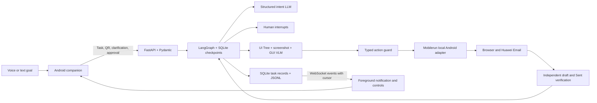

# SilverGuide 2.0 architecture

The Android companion and a local computer form one controlled prototype. The phone connects with USB ADB; `adb reverse tcp:8000 tcp:8000` carries HTTP/WebSocket traffic. The backend binds to loopback only.

## Modules

| Boundary | Implementation | Responsibility |
| --- | --- | --- |
| Interaction/API | `api/application.py`, `api/routes.py`, `api/schemas.py` | Validate requests and human decisions; stream events; contacts and explanations. |
| Understanding/planning | `agent/models.py` | Structured LLM intent and screenshot/UI-based action candidates. Model text never becomes shell commands. |
| Orchestration | `agent/graph.py`, `agent/runtime.py` | Actual LangGraph nodes, SQLite checkpoints, clarification/QR/approval interrupts, cancellation and safe recovery. |
| Perception | `perception/observe.py` | Candidate IDs for controls observed in the current screen. |
| Device execution | `device/mobilerun.py`, `device/huawei.py` | Local Mobilerun SDK for UI, screenshots and taps; constrained ADB intents and the companion's Unicode input bridge. |
| Safety/verification | `safety/actions.py`, `verification/mail.py`, `domain.py` | Field/action restrictions, draft digest and nonce, single attempt, exact readback and outcome evidence. |
| Evidence/evaluation | `storage/`, `evaluation/`, `explanation/` | Contacts, ordered events, factual templates and honest pilot metrics. |

## Graph and external effects

`understand → clarify (if needed) → scan (if needed) → precheck → browser → draft → approval → send → verify`.

Clarification, real QR return, and approval use `langgraph.types.interrupt`; replies resume the same thread with `Command(resume=...)`. Each retry/edit uses a new graph-run ID and a new approval nonce. Graph checkpoints are separate from durable task/effect records.

Before dispatching Send, the runtime checks the current original composer, recipient, entire subject/body, digest and approval. It commits `send_attempts = 1` before clicking. A process failure never causes automatic replay; ambiguous external results become UNKNOWN. LangGraph persistence is not a claim of network-level exactly-once email delivery.

The model may propose only typed, observed preparation actions. Send and approval are not available to the model. A guessed recipient address or URL is discarded unless grounded in explicit user input or a saved, explicit contact mapping. Actual QR callbacks supply QR data.

## Background operation

`TaskConnectionService` holds a WebSocket, persists its cursor and latest task, reconnects after interruption, and displays a foreground notification with pause/resume/cancel actions. TTS progress continues while another app is foreground. A control request is not announced as successful until acknowledged by the backend.

The native scanner remains in the companion (ZXing). The original proposal's preference for an existing phone scanner is a documented implementation variation; course acceptance of this route is an external question. Mobilerun uses its local ADB backend, with Portal enhancements available when configured. No cloud-phone service is required.

## Speech and privacy

Huawei's system recognition did not return usable text in testing. AAC recording plus locally loaded faster-whisper replaces that dependency. Recording stops on background/timeout/cancel; temporary clips are deleted. No cloud ASR or API key is used for transcription.

LLM/VLM requests use the configured provider. Model logs retain stage, model, token counts, timing and an input hash, not API keys or raw prompts. Local task/draft databases and screen evidence contain test-mail data needed for review and verification; they are Git-ignored. `tools/prune_evidence.py` previews expired terminal-task screen evidence by default; deletion requires `--apply`. Effect/idempotency records remain intact.
