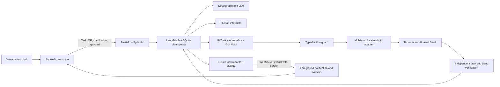

# SilverGuide 2.0 architecture

The Android companion and a local computer form one controlled prototype. The phone connects with USB ADB; `adb reverse tcp:8000 tcp:8000` carries HTTP/WebSocket traffic. The backend binds to loopback only.

## Modules

| Boundary | Implementation | Responsibility |
| --- | --- | --- |
| Interaction/API | `api/application.py`, `api/routes.py`, `api/schemas.py` | Validate requests and human decisions; stream events; contacts and explanations. |
| Understanding/planning | `agent/models.py` | Structured LLM intent and screenshot/UI-based action candidates. Model text never becomes shell commands. |
| Orchestration | `agent/graph.py`, `agent/runtime.py` | Actual LangGraph nodes, SQLite checkpoints, clarification/QR/approval interrupts, cancellation and safe recovery. |
| Perception | `perception/observe.py` | Candidate IDs for controls observed in the current screen. |
| Device execution | `device/mobilerun.py`, `device/huawei.py` | Local Mobilerun SDK for UI, screenshots and taps; constrained ADB intents and the companion's Unicode input bridge. |
| Safety/verification | `safety/actions.py`, `verification/mail.py`, `domain.py` | Field/action restrictions, draft digest and nonce, single attempt, exact readback and outcome evidence. |
| Evidence/evaluation | `storage/`, `evaluation/`, `explanation/` | Contacts, ordered events, factual templates and honest pilot metrics. |
| AutoGLM route assistance | `autoglm/assist.py`, `client.py`, `protocol.py`, `safety.py` | Optional bounded single-step help when the rules-owned public-transit entry is absent; candidate grounding, device dispatch, re-observation and a postcondition precede return to the existing rules flow. |
| AutoGLM route execution (legacy experiment) | `autoglm/config.py`, `client.py`, `protocol.py`, `safety.py`, `executor.py` | Separately selected model-led loop, retained for the earlier experiment and using the same device worker and route verifier. |

## Two route executors

`SILVERGUIDE_TRANSIT_EXECUTOR=rules` selects the native-control Amap adapter.
With `SILVERGUIDE_AUTOGLM_ASSIST_ENABLED=true`, a verified target-missing condition
at the supported public-transit entry may invoke a single bounded model-assisted
Tap and then continue this same adapter; other failures do not invoke assistance.
See [AutoGLM assistance](AUTOGLM_ASSIST.md).
`autoglm` starts a separate, explicit screenshot→remote decision→strict parse→
independent grounding→device execution→new observation loop inside the same
SilverGuide worker. The normal sequence is chosen by the model, not a rules
fallback or another upstream PhoneAgent thread. Missing credentials, rejected
actions and API failures do not change executors. Configuration is separate
from the DeepSeek ModelGateway used for understanding and fact extraction.

The executor is frozen on each query. Human-choice/clarification resumes
re-observe within the same query; process restarts mark unfinished work
interrupted and never automatically replay device side effects. Explicit new
queries may adopt the new process default and retain earlier mode provenance.
Actions and observations are locally audited without raw model thoughts.
Finish only requests the existing evidence-based route extractor/verifier;
the model's prose cannot certify completion. See [AutoGLM route mode](AUTOGLM_TRANSIT.md).

## Graph and external effects

`understand → clarify (if needed) → scan (if needed) → precheck → browser → draft → approval → send → verify`.

Clarification, real QR return, and approval use `langgraph.types.interrupt`; replies resume the same thread with `Command(resume=...)`. Each retry/edit uses a new graph-run ID and a new approval nonce. Graph checkpoints are separate from durable task/effect records.

Before dispatching Send, the runtime checks the current original composer, recipient, entire subject/body, digest and approval. It commits `send_attempts = 1` before clicking. A process failure never causes automatic replay; ambiguous external results become UNKNOWN. LangGraph persistence is not a claim of network-level exactly-once email delivery.

The model may propose only typed, observed preparation actions. Send and approval are not available to the model. A guessed recipient address or URL is discarded unless grounded in explicit user input or a saved, explicit contact mapping. Actual QR callbacks supply QR data.

## Background operation

### In-App demonstration cases

The companion exposes 19 cases, T02–T20, locally in `DemoCases.kt`, split into
map (T13–T20) and mail (T02–T12) domains, each with recommended/normal/checks/
recovery filters. Mail normal contains only T02: one complete QR-to-email task;
map normal has T13 and T14. Normal cases have no step-by-step subcases. Checks
and recovery retain expandable instructions. Recommended mail cases are T02,
T04 and T12; recommended map cases are T13, T15 and T18. T01 is not shown in the
picker, while the backend still accepts all 20 IDs. These examples do not
select the route executor: the current explicit backend configuration does.
A small header entry opens `DemoCasePickerSheet`; selection fills a prompt with
a fresh subject suffix, without starting a task. The user starts the complete
normal flow once, and still approves the verified draft before sending.
An active task cannot be replaced by a case selection. The client checks
`/api/system/demo-capabilities` before enabling recovery demos.

The completion dialog says “任务已完成，请点击确认”. It requires `completed` plus
`webpage_verified` for an open-URL task, or `completed` plus `delivery_confirmed`
for an email task after the receipt-confirmation request succeeds. A sent-record
check alone does not trigger it; failure, cancellation and unknown outcomes do
not trigger it. “确认，返回首页” clears the current input, selected demo, progress
and form state and scrolls to the top, while retaining saved contacts, voice
preferences and backend task history.

Only explicit T12 metadata can arm the regular backend's per-task foreground-loss
demo. `device/demo.py` registers the one-shot attempt before HOME and requires an
actual non-composer observation. The scoped observer is restored on graph return;
approval, sending and verification never arm the fault. Normal case metadata is
observational only. The CLI driver shares the same injection primitive and task-ID
deduplication rather than adding a separate recovery implementation.

### Bounded recovery before sending

`safety/recovery.py` classifies native dialogs by their observed ownership,
container, title, content and unique enabled dismiss control. Only known
informational/update hints can be dismissed. Sensitive, unknown or ambiguous
dialogs stop execution; web content cannot authorize a native-dialog click.
The adapter re-observes and re-classifies immediately before dismissal.

The Huawei adapter waits for transient missing composer controls and may bring
the recorded original composer activity back once. It never reopens `mailto:`
as an automatic recovery action. The recipient and extra-recipient/attachment
checks still apply after recovery; a changed approved draft requires new review.
An unsuccessful field replacement can be retried once and is reported recovered
only after its exact value is read back. Each browser/draft preparation stage
has a budget of three recovery attempts, and every action checks pause/cancel.
`send_once` is outside these loops: an uncertain send remains verification-only.

Recovery events are written to the task's `recoveries.jsonl` and published
through the existing durable task/event stream. Optional task fields are
`recovery_count`, `last_recovery` and the most recent 20 `recovery_events`.
The task retains its actual phase rather than creating a second approval path.
See [recovery test cases](RECOVERY_TEST_CASES.md) and the explicitly labelled
`tools/run_recovery_demo.py` real-phone foreground-loss injection driver.

`TaskConnectionService` holds a WebSocket, persists its cursor and latest task, reconnects after interruption, and displays a foreground notification with pause/resume/cancel actions. TTS progress continues while another app is foreground. A control request is not announced as successful until acknowledged by the backend.

The native scanner remains in the companion (ZXing). The original proposal's preference for an existing phone scanner is a documented implementation variation; course acceptance of this route is an external question. Mobilerun uses its local ADB backend, with Portal enhancements available when configured. No cloud-phone service is required.

## Speech and privacy

Huawei's system recognition did not return usable text in testing. AAC recording plus locally loaded faster-whisper replaces that dependency. Recording stops on background/timeout/cancel; temporary clips are deleted. No cloud ASR or API key is used for transcription.

LLM/VLM requests use the configured provider. Model logs retain stage, model, token counts, timing and an input hash, not API keys or raw prompts. Local task/draft databases and screen evidence contain test-mail data needed for review and verification; they are Git-ignored. `tools/prune_evidence.py` previews expired terminal-task screen evidence by default; deletion requires `--apply`. Effect/idempotency records remain intact.
